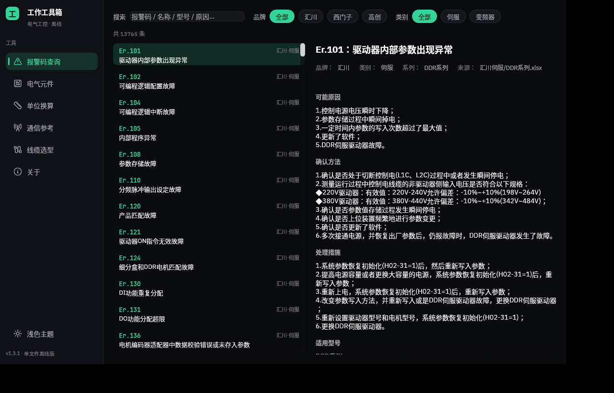
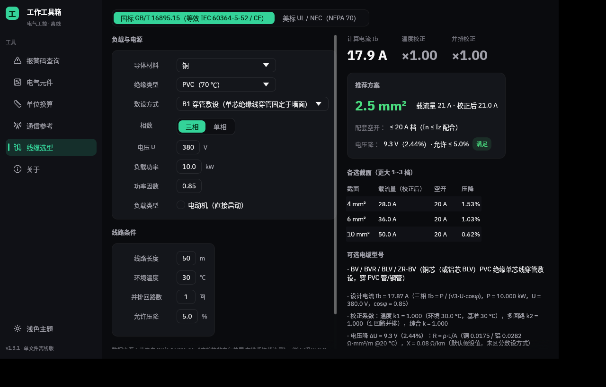

# 工作工具箱 · Windows 版

用 **Rust + [egui/eframe](https://github.com/emilk/egui)** 重写的「工作工具箱」Windows 桌面版：
**单文件、免安装、完全离线**，面向电气 / 工控现场的日常速查与选型计算。

当前版本 **v1.4.0** ｜ 黑色高级主题（默认）+ 浅色主题一键切换 ｜ 左侧一级菜单导航





（其余截图见 `docs/screenshots/`，含「检索 234 精确结果」修复示例）

## 功能一览

| 模块 | 说明 |
| --- | --- |
| 🔍 报警码查询 | **13765 条**（汇川 / 西门子 / 高创 · 伺服 / 变频器）。**码式搜索**（输入 `234` / `er.234` 精确匹配报警码）＋ **全文检索**（中文 / 多词可搜原因、措施）；品牌 · 类别 · **系列**三级筛选；详情含**可能原因 / 确认方法 / 处理措施 / 适用型号 / 原始表格来源** |
| ⚡ 电气元件 | 30 个常用元件渲染图 + 用途原理 + 工程要点 |
| 📐 单位换算 | 22 个类别（含线规 AWG、压力、力矩、功率等），单位对调 + 全类别对照表 |
| 🔌 通信参考 | 26 个 PLC 数据类型 + 8 类通信协议要点（Modbus / EtherCAT / PROFINET / CANopen / OPC UA / S7 / RS-485） |
| 🧮 线缆选型计算 | 国标 GB / 欧标 IEC·EN（CE）/ 美标 UL·NEC：载流量选型、温度与并排校正、电压降校验、空开配合、电缆型号建议 |

## 界面设计

- **黑色高级主题（默认）**：主黑 `#0A0B0E` + 侧栏 `#101116` + 祖母绿 `#34D399`；侧栏底部一键切换浅色主题
- 设计系统由开源技能 [ui-ux-pro-max](https://github.com/nextlevelbuilder/ui-ux-pro-max-skill)（GitHub 最高星设计类技能）生成 —— Swiss Minimalism：单强调色 / 令牌化配色 / 8dp 间距节奏
- **Lucide** 矢量图标（编译期嵌入 + 任意着色）、**IBM Plex Sans + JetBrains Mono**（OFL 字体），中文自动使用系统字体（微软雅黑 / Noto CJK）
- 全部控件自绘：悬停动画 / 焦点环 / 对比度按 4.5:1 校核

## 构建方法

### ① Windows 本机（推荐）
1. 安装 [Rust](https://rustup.rs/)（stable 即可）
2. `cargo build --release`
3. 产物：`target\release\worktoolbox-win.exe`（单文件，数据已内嵌）

### ② Linux 交叉编译（本仓库的原始开发方式）
```bash
rustup target add x86_64-pc-windows-gnu
sudo apt install mingw-w64            # Debian / Ubuntu
cargo build --release --target x86_64-pc-windows-gnu
```

### ③ Linux 本机运行（调界面用）
```bash
cargo run
```

> 运行时自动加载系统 CJK 字体（Windows 用微软雅黑 msyh.ttc，Linux 用 Noto Sans CJK）。
> 仓库不含 `.cargo/config.toml`（开发机本地配置），需要时自行创建。

## 项目结构

```
├── src/
│   ├── main.rs            # 入口（窗口 / 图标 / 字体与图片加载器）
│   ├── app.rs             # 应用外壳：左侧一级菜单 + 页面路由
│   ├── theme.rs           # 设计系统：明/暗双主题令牌 + 全局控件样式
│   ├── ui.rs              # 自绘组件库（卡片 / 胶囊 / 分段控件 / 菜单项 …）
│   ├── icons.rs           # Lucide 图标（编译期嵌入 + 纹理缓存）
│   ├── fonts.rs           # 字体管线（内置拉丁字体 + 系统中文回退）
│   ├── screens/           # 页面：报警 / 元件 / 单位 / 通信 / 线缆 / 关于
│   └── data/              # 数据层：报警库 / 单位表 / 线缆引擎 / 通信表 / 元件资料
├── assets/                # 应用图标 + 元件渲染图 + 图标 + 字体（编译期内嵌）
├── data/
│   ├── alarms.bin         # 报警库（postcard 紧凑格式，已提交，克隆即可构建）
│   └── standards/         # 线缆标准数据 JSON（可编辑，编译期内嵌）
├── docs/                  # 开发计划（PLAN.md）+ 界面截图
├── tools/                 # 数据生成 / 打包 / 截图 辅助脚本（含数据清洗管线）
└── build.rs               # Windows exe 图标资源（winresource）
```

## 数据说明

- `data/alarms.bin`：由原数据的 SQLite 库经 `tools/convert_alarms.py` 转换生成的 postcard 二进制（17.6MB）。
  **转换管线含数据清洗**：多码合并行拆分（如原始表 `"Er.220：内部故障\nEr.234：飞车"` → 两条独立记录）、
  名称换行合并、空码推导、检索文本统一重建。
  exe 内嵌一份作兜底；程序目录放置 `data/alarms.bin` 时优先使用外置文件（便于**不重编译**更新数据）。
- `data/standards/gb_iec.json` / `ul.json`：线缆载流量与校正系数节选表
  （IEC 60364-5-52 ≈ GB/T 16895.15、NEC 310.16 等，来源见 `data/standards/README.md`）。**改完 JSON 重新构建即生效**。
- 全部数据与计算结果供工程参考；正式设计、选型与施工请以现行标准原文及厂家资料为准。

### 第三方资源

| 资源 | 许可 |
| --- | --- |
| [IBM Plex Sans](https://github.com/IBM/plex) / [JetBrains Mono](https://github.com/JetBrains/JetBrainsMono) | OFL-1.1 |
| [Lucide](https://lucide.dev/) 图标 | ISC |

## 更新日志

见 [CHANGELOG.md](CHANGELOG.md)（v0.1 → v1.4.0 全部迭代）。

## 开发建议

- `main` 分支与交付成品保持一致；新需求建议开 `feat/xxx` 分支开发（PR #1~#4 可参考流程）。
- 界面相关改动可先用 `tools/screenshot.sh`（Xvfb 无头截图）自测，或直接 `cargo run` 看效果，再合并。
- 调试环境变量：
  - `WTB_START_SCREEN=alarm|electrical|units|comms|cable|about` —— 启动到指定页面
  - `WTB_THEME=dark|light` —— 指定初始主题
  - `WTB_QUERY=234` —— 预填报警搜索词
  - `WTB_SERIES=DDR系列` —— 预填系列筛选
